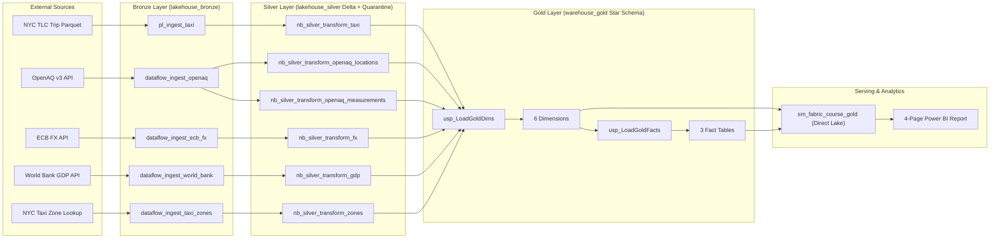

# NYC Taxi & Air Quality (Microsoft Fabric)

Microsoft Fabric medallion project combining NYC Yellow Taxi trips, OpenAQ air quality, ECB EUR/USD rates, and World Bank US GDP across 2023-2025.

---

## Lineage

Master pipeline orchestration: `pipelines/pl_medallion_master`.

---

## Data Model

Full table grains, SQL types, and keys are in [DATA_DICTIONARY.md](docs/DATA_DICTIONARY.md).

- Dimensions: `DimDate`, `DimFX` (1:1 bidirectional with `DimDate`), `DimGDP`, `DimZone`, `DimSensors`, `DimHour`
- Facts: `FactTaxiDaily`, `FactTaxiHourly`, `FactAirQualityDaily`

---

## Quality & Governance

- **Bronze-to-Silver Quarantine:** Invalid records in each Silver notebook are routed to `*_quarantine` Delta tables with a `dq_error_reason` tag instead of being silently dropped.
- **Financial Precision:** Money, FX rates, and macro GDP columns use fixed-point `DECIMAL` types, with zero-safe EUR conversions in Gold.
- **Orchestration & Security:** `pl_medallion_master` runs 5 parallel Bronze-to-Silver branches with retries, a configured daily refresh schedule, and a `SecureString` pipeline parameter for `OpenAQApiKey`.
- **Row-Level Security (RLS):** `sm_fabric_course_gold` defines 3 roles (`Airport_Operations`, `NYC_Five_Boroughs`, `EPA_Monitors_Only`).

---

## Power BI Dashboard

Built in Direct Lake mode over `warehouse_gold` (PDF export: [Power BI dashboard.pdf](docs/Power%20BI%20dashboard.pdf)):

1. **Mobility:** `124M` trips, `145M` passengers, `421.44M` miles (`3.41 mi` avg, `17.51 min` avg duration, `$28.89` avg revenue), daily trend with the Sept 2023 TLC gap note, borough-to-zone drill-down, and hourly rush-hour profile.
2. **Air Quality:** NYC sensor map, single-select pollutant filter (`pm25`, `no2`, `o3`, etc.), weighted KPIs (`9.15 µg/m³` PM2.5, `816.49` peak, `95.99%` coverage), daily trend showing the June 2023 wildfire spike, and station rankings.
3. **Correlation:** Daily taxi vs. weighted pollutant overlay, weekday vs. weekend trend (`-2.51%` PM2.5 delta), dual scatter plots (trip count vs. AQ and distance vs. AQ), and station rankings.
4. **Economics & Macro:** 2023-2025 scorecard (US GDP `$27.81T-$30.77T`, `$3.57B` / `3.25B€` total revenue, `123.65M` trips), daily USD vs. EUR per-trip revenue, and ECB `USD/EUR` FX trend.

---

## Insights

- **Urban mobility:** Demand peaks during the `18:00` evening rush and concentrates heavily in Manhattan and Queens airports (JFK/LGA), with steady ridership growth from `2023` (`37.91M`) to `2025` (`45.32M`).
- **Air quality vs. taxi traffic:** Daily Yellow Taxi trips and distance show no strong linear correlation with citywide `PM2.5` (`-2.51%` weekday vs. weekend delta); extreme pollution spikes (like June 2023 at `816.49 µg/m³` peak) are driven by regional wildfire events rather than cab volume.
- **FX & macro economics:** Total revenue grew from `$1.10B` (`2023`) to `$1.31B` (`2025`) alongside ridership growth (`37.91M` to `45.32M` trips) while average per-trip revenue stayed near `$28.89`. In `2025`, as `USD/EUR` rose from `~1.02` to `~1.18`, USD revenue climbed from `$1.16B` to `$1.31B` while EUR revenue grew more slowly (`1.07B€` to `1.16B€`).
